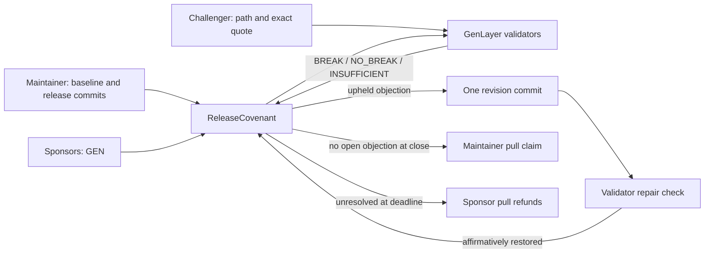

# Release Covenant

Release Covenant is a GenLayer Native app for a public software release promise. A sponsor funds a covenant, anyone can challenge one documented promise with commit-pinned GitHub evidence, and validators judge whether that exact evidence shows a break. The maintainer gets one revision round. An upheld objection must be positively repaired at the revised commit; unresolved objections trigger pull refunds at the deadline.

**Current state:** the frontend and contract are built, and six direct-mode tests pass. The [evidence probe](deploy/probe-proof.json) finalized three validator fetches of the pinned baseline, break, and repair files. Two [main contract](deploy/proof.json) [demonstrations](deploy/refund-proof.json) are deployed on StudioNet: each has a finalized, validator-upheld `BREAK`, a sealed promise, and 1 test GEN of sponsorship. The refund demonstration also has a finalized expected `ERROR` for a duplicate challenge. The repair, settlement, and refund windows are still pending. Run `pnpm verify:proof`, `pnpm verify:refund`, and `pnpm verify:probe` for byte-identical source, finality, leader execution, votes, and finalized state. The [hosted app](https://release-covenant-genlayer-20261020.opalfairy1.chatgpt.site/) is a private preview.

## Mechanism



The model only returns a bounded label. Validators independently fetch both raw GitHub files at 40-character commits, verify the submitted quotes, and repeat the narrow judgment. The contract compares the entire state-affecting result: the label. File paths and quotes come from transaction inputs and are stored only after a `BREAK` verdict. A repair must receive `REPAIRED`, which requires affirmative evidence of restored behavior. Deterministic code controls deadlines, the one-revision limit, and every wei of the sponsor pool.

The initial round ends at `first_close`. With no upheld objection, anyone can settle and credit the maintainer. With an open objection, the maintainer may provide one new commit before `revision_deadline`. Each upheld objection is carried to round two and must be rechecked against the new commit. New challenges remain possible until `final_close`. Unresolved `OPEN` or `CARRIED` states cause refunds. A revision never silently clears an objection.

## Run locally

Requires Node.js 20+ and Python 3.12+.

```sh
pnpm install
pnpm dev
pnpm build
python -m pip install genlayer-test
python -m pytest tests/test_direct.py -q
```

The app uses the stable `genlayer-js` 1.1 line and StudioNet. A wallet and StudioNet test GEN are needed to deploy and write. The Create form deploys the included contract source; then the maintainer adds up to four promises and seals the covenant. Paste a deployed address into the Explore form for finalized reads. Submitted transaction IDs are kept in browser local storage and polled every eight seconds across reloads. The app checks status and execution separately and exposes native appeals during an appealable accepted state.

`node deploy/probe.mjs` asks StudioNet to parse the pinned-runner contract schema without signing or deploying. `pnpm verify:proof` checks the repair-path contract; `pnpm verify:refund` checks the timeout-path contract, including the expected duplicate-challenge rollback. Both manifests currently record active covenants. Their expected snapshots will be updated after their deadlines and claims finalize.

## Evidence contract

- Repository is a public `owner/repo` path. Baseline and release commits are full SHAs; paths are bounded and cannot contain traversal segments.
- Files must be UTF-8, HTTP 200, and at most 24 KB raw. Quotes must be exact substrings. Failure returns `INSUFFICIENT`, without opening or clearing an objection.
- The judgment concerns a **documented compatibility promise**. It does not prove runtime behavior, project ownership, or that an unchallenged promise is true.
- Anyone may instantiate a covenant naming any public GitHub repository. Sponsors should inspect the maintainer wallet, baseline quote, terms, and deadlines before funding.
- Raw GitHub reachability from a local browser does not prove validator reachability. Test it with an on-network fetch before relying on a demo repository.
- The Site preview is private. Its recorded receipt list comes from `deploy/proof.json`; its covenant state is fetched live from StudioNet. The independent historical replay is not an upstream maintainer promise. Public GitHub source is a separate publication step.

## Safety and accounting

The contract accepts late or premature payable sponsorship into a direct refundable credit, avoiding trapped value if a failed payable call still credits the ghost contract. Valid sponsorship is recorded per address. Successful settlement credits the maintainer exactly the total sponsored amount. Refund settlement lets each sponsor move its exact recorded deposit into a pull credit. `withdraw()` clears the credit before emitting a finalized external transfer to the caller.

All consensus-critical source values are copied to locals before the nondeterministic closure. The validator re-fetches and re-judges; it rejects forged labels. External content is explicitly treated as untrusted prompt data. The contract has finite promise count, evidence size, windows, and revision count.

## Live replay and remaining gates

1. The [historical replay fixture](deploy/demo-fixture.json) pins three real upstream commits and exact `pyproject.toml` quotes for Python 3.10 support, removal, and restoration. Run `pnpm verify:fixture` to recheck raw bytes and quotes. This replay is independent and is not a promise by the upstream maintainer.
2. [Repair-path proof](deploy/proof.json) records a finalized `BREAK` and an active 1 GEN pool. The first challenge window closes at its recorded UTC timestamp; the maintainer may then submit the repair commit. Its repair verdict, settlement, and withdrawal still need live receipts.
3. [Refund-path proof](deploy/refund-proof.json) records another finalized `BREAK`, sponsorship, and a finalized duplicate-challenge rollback. No revision will be submitted to this instance. Settlement, refund claim, and withdrawal still need live receipts after the revision deadline.
4. A real browser wallet test of the hosted app's deploy, fund, act, claim, and appeal controls remains. Studio's funded test accounts exercised the contract directly, while the public read path was tested in the hosted app.
5. Publish a public source repository and make the Site reviewable only after the live receipts and docs are complete. The operator must submit the Portal form.

For a code walk-through, see [tutorial.md](tutorial.md). GenLayer API references: [nondeterministic operations](https://docs.genlayer.com/understand-genlayer-protocol/core-concepts/non-deterministic-operations-handling), [storage](https://docs.genlayer.com/developers/intelligent-contracts/storage), [value transfers](https://docs.genlayer.com/developers/intelligent-contracts/features/value-transfers), [StudioNet](https://docs.genlayer.com/developers/networks), [direct-mode testing](https://docs.genlayer.com/developers/intelligent-contracts/testing).
